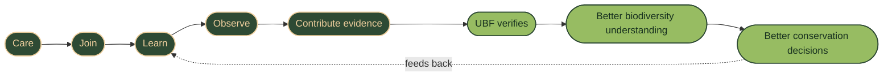
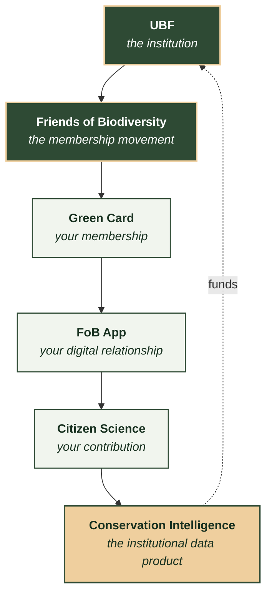
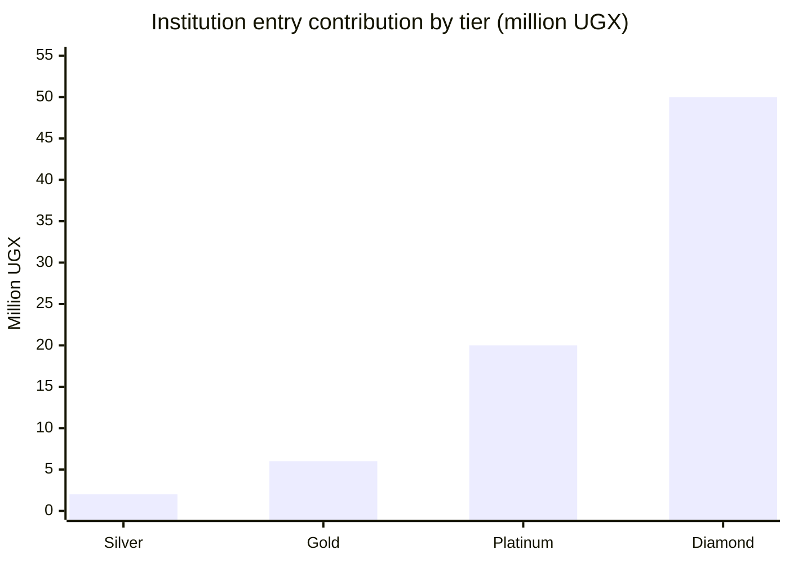
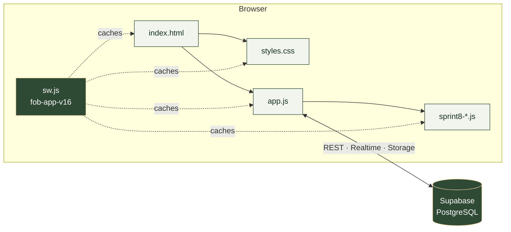

<div align="center">


# Friends of Biodiversity

### Uganda Biodiversity Fund · Green Card Programme

**Become part of Uganda's biodiversity intelligence network.**

A progressive web app where members join, pay, learn, observe and follow UBF's
conservation impact — and where UBF staff run the entire programme from a
built-in admin console.

<br/>


</div>

---

## The member journey

<div align="center">
<table>
<tr>
<td align="center" width="20%"><br/><b>Care</b><br/><sub>Protect what you love</sub></td>
<td align="center" width="20%"><br/><b>Join</b><br/><sub>Choose a Green Card tier</sub></td>
<td align="center" width="20%"><br/><b>Learn</b><br/><sub>Learning Exchange</sub></td>
<td align="center" width="20%"><br/><b>Observe</b><br/><sub>Log a sighting</sub></td>
<td align="center" width="20%"><br/><b>Contribute</b><br/><sub>Verified evidence</sub></td>
</tr>
</table>
</div>



---

## Product architecture

Each layer earns the next. The institution gives the movement legitimacy; the
movement gives the data product its supply.



---

## Green Card tiers

Annual contributions in Uganda Shillings. Source of truth is `TIERS_DATA` and
`TIER_RANGES` in [`app.js`](app.js) — these figures are read from the code, not
maintained separately here.

| | Tier | Individual | Institution | Scale (institution minimum) |
|---|---|---|---|---|
| 🎓 | **Student** | In-kind / youth project work | — | *in-kind* |
| 🥈 | **Silver** | 500K – 1M | 2M – 5M | `█` |
| 🥇 | **Gold** | 1.5M – 2M | 6M – 10M | `███` |
| 💎 | **Platinum** | 2.5M – 4.5M | 20M – 40M | `██████████` |
| 🔷 | **Diamond** | 5M+ | 50M+ | `█████████████████████████` |



Tiers are cumulative — every tier carries the one below it, then adds to it.
Benefits per tier live in `PERKS_MAP` in [`app.js`](app.js).

---

## Three markets, one platform

| Audience | The proposition | What the platform gives them |
|---|---|---|
| **Citizens** | Protect what you love | Membership, Green Card, learning library, community, sighting log |
| **Institutions** | Put biodiversity into practice | Partnership pathway, co-branding, ESG reporting, named projects |
| **Technical buyers** | Better biodiversity evidence for better decisions | Conservation Intelligence catalogue, data packs, structured enquiries |

---

## What the app does

<details open>
<summary><b>For visitors</b> — the marketing site</summary>

- Hero slideshow, programme windows and thematic areas
- **"What you're protecting"** conservation gallery
- Green Card tiers with linked conservation propositions
- How to Pay — Stanbic, MTN MoMo, Airtel
- Guided enrollment wizard with email verification
- Uganda Biodiversity Pulse and the accountability trust engine

</details>

<details>
<summary><b>For members</b> — the app shell</summary>

- Home, Learning, Chats, Alerts and Profile tabs
- Green Card membership, renewal and tier changes
- Citizen Science observation workflow
- Conservation identity badges
- Observation, intelligence-product and membership workspace

</details>

<details>
<summary><b>For institutions and technical buyers</b></summary>

- Institutional partnership pathway
- Conservation Intelligence catalogue
- Structured intelligence enquiries
- Data-pack, research and monitoring positioning

</details>

<details>
<summary><b>For admins</b> — the console</summary>

- Overview KPIs and revenue by tier
- Member approval, verification and renewals
- Content library, Wall of Fame, announcements, financial reports
- Payment details, conservation gallery, ad campaigns, events, fundraisers
- Audit log and the growth/intelligence cockpit

</details>

---

## Architecture

| Layer | Technology |
|---|---|
| Front end | Vanilla HTML / CSS / JS single-page app — `index.html`, `styles.css`, `app.js` |
| Feature layer | `sprint8-runtime.js`, `sprint8-auth-profile.js`, `sprint8-ui.js`, `sprint8-strategy.js`, `sprint8-pulse-filters.js`, `sprint8-member-package.js` |
| Backend | Supabase — PostgreSQL, Realtime, Storage, Auth |
| PWA | `manifest.json` + `sw.js`, versioned cache |
| Hosting | Static deployment from `fob-8-sprint` |

There is **no build step and no package manager.** Files are served as written,
which is why the service-worker cache version matters so much.



---

## Deployment

Deploy from **`fob-8-sprint`**.

The service worker cache is **`fob-app-v16`**. It precaches the app shell, the
`sprint8-*` layer and the brand images, images **cache-first**. That means:

> **Bump `CACHE_NAME` in `sw.js` whenever you change a precached asset.**
> Replacing an image without bumping it leaves every returning visitor on the
> old file indefinitely — the new one is never fetched.

After a deployment, hard-refresh once (`Ctrl`+`Shift`+`R`) so the new worker
can install.

---

## Brand assets

| File | Size | Used for |
|---|---|---|
| `fob-logo.png` | 1024² | the FoB mark — header, footer, admin header, certificate, impact card |
| `ubf-logo.png` | — | the UBF institutional logo |
| `icon192.png` · `icon512.png` | 192² · 512² | PWA install icons |
| `icon-512-maskable.png` | 512² | Android adaptive icon, mark inset to 72% |
| `fobfav32/64/180/192.png` | — | favicons and the iOS touch icon |
| `docs/assets/icon-*.svg` | 64² | animated journey icons for this README |

The FoB mark is a circular badge — gold tree and hands on forest green.

> **These filenames are fixed.** Eleven references across `index.html`, `app.js`
> and `sw.js` resolve against them. Replace the file contents, never the names.

Every slot that renders `fob-logo.png` is square with `object-fit: contain`, and
`.adb-logos`, `.is-logos` and `.ic-foot` additionally force `border-radius: 50%`.
A square, circular mark is therefore required — a landscape image letterboxes.

**Palette**

| Swatch | Hex | Role |
|---|---|---|
| 🟩 | `#2E4A34` | forest green — the badge field, primary surface |
| 🟨 | `#EFCF9E` | champagne gold — the mark, accents |
| 🟢 | `#97BC62` | moss — secondary accent |

---

## Data integrity

Public impact metrics are rendered from published UBF programme records.
Missing figures remain **unreported rather than invented**. Uganda Biodiversity
Pulse uses live biodiversity evidence where available; Region and Threat are
shown as planned dimensions until those fields are populated in the source data.

---

## Repository layout

```
index.html                     markup: marketing site, member app, admin console
styles.css                     all styling
app.js                         application logic, tiers, data layer
sw.js                          service worker — bump CACHE_NAME on asset change
manifest.json                  PWA manifest

sprint8-runtime.js             Sprint 8 runtime
sprint8-auth-profile.js        auth bridge and profile
sprint8-ui.js                  visible feature layer
sprint8-strategy.js            strategic product layer
sprint8-pulse-filters.js       Uganda Biodiversity Pulse filters
sprint8-member-package.js      member package mounting

supabase/migrations/*.sql      schema, analytics, security corrections
docs/*.md                      brand, go-to-market, performance budget, execution
docs/assets/*.svg              animated icons used by this README
```

---

<div align="center">


**Uganda Biodiversity Fund**

*Demonstrating care for Uganda's biodiversity*

[info@ugandabiodiversityfund.org](mailto:info@ugandabiodiversityfund.org) · [www.ugandabiodiversityfund.org](https://www.ugandabiodiversityfund.org)

</div>
